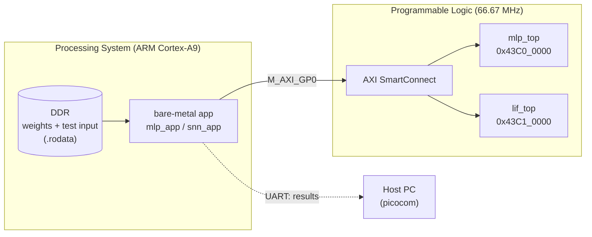
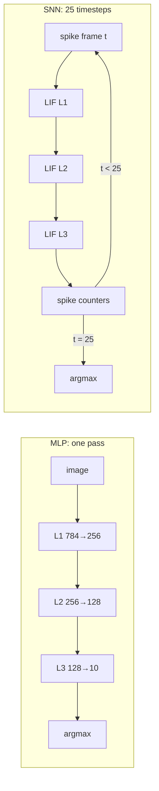

# LIF vs MLP on Zynq

<!-- banner: docs/images/banner.png -->

This project runs two hardware neural-network accelerators on a **ZedBoard (Zynq-7020)** and compares them on the same MNIST task:

- an **int8 MLP** (multi-layer perceptron)
- a **spiking neural network** made of **LIF neurons** (leaky integrate-and-fire)

Each accelerator is a custom Verilog IP with an **AXI-Lite** register interface. The ARM core loads the weights at runtime, sends in an image, and reads back the prediction and the hardware cycle counters.

> Status: both accelerators pass on the board and match the Python golden models bit for bit.

---

## System overview



<!-- screenshot: docs/images/block_design.png (Vivado block design) -->

## The two networks

Both networks use the same shape: **784 → 256 → 128 → 10**.

| | MLP | SNN (LIF) |
|---|---|---|
| Input | 784 int8 pixels | 784 spikes per timestep, 25 timesteps |
| Neuron | MAC, then requantise (`>>>`) + bias, ReLU, saturate to int8 | membrane decay `(v·243)>>8`, add `w<<1` on each spike, fire at 256, reset to 0 |
| Output | 10 int8 logits, argmax | 10 spike counts, argmax |
| Weights | int8, plus biases | int8, no biases |
| One image | 1 forward pass | 25 forward passes (one per timestep) |



## Results (ZedBoard, PL clock 66.67 MHz)

The test input is a single MNIST digit.

| Metric | MLP | SNN (LIF) |
|---|---|---|
| Prediction | 1 ✅ (matches golden) | 6 ✅ (matches golden) |
| Output | logits `[-77, 80, -41, 4, 0, -61, -56, 11, -28, -32]` | counts `[3, 0, 0, 0, 1, 2, 12, 0, 4, 0]` |
| Hardware cycles per image | **471,085** | **11,767,299** (25 timesteps) |
| Latency per image | **7.07 ms** | **176.5 ms** |
| MACs skipped (input spike = 0) | n/a | 4,920,466 of 5,868,800 (**83.8 %**) |
| BRAM (both IPs together) | 132 / 140 RAMB36 | |

**Main observation:** the SNN skips about 84 % of its multiply-accumulates, but one SNN timestep (about 470k cycles) still costs as much as a whole MLP pass. So in the current design, the sparsity is counted but does not yet turn into fewer cycles. Making skipped MACs actually take no time is the next optimisation.

> PS-side timings (weight load and polling) are left out for now. The software timer currently reads 4× low, and this is being fixed.

## Register map (both IPs, 4 KB each)

| Offset | Name | Access | Meaning |
|---|---|---|---|
| `0x000` | CTRL | RW | `[0]` start, `[1]` soft reset |
| `0x004` | STATUS | RO | MLP: `{rejected, ready, running, done}`. SNN: `{chain_ready, pass_done, running, done}` |
| `0x008` | CYCLES | RO | hardware compute cycles |
| `0x00C` | SKIPPED | RO | SNN only: skipped MACs |
| `0x010` | PDATA | W/R | write one weight byte (the write pointer then increments). Read returns the pointer |
| `0x014` | PCTRL | W/R | `[1:0]` layer, `[2]` reset pointer, `[3]` MLP only: 0 = weights, 1 = bias |
| `0x018` | IN_DATA | W | input words (MLP: 4 pixels per word; SNN: 32 spikes per word) |
| `0x01C` | IN_PTR_RST | W | reset the input pointer |
| `0x020` | PRED | RO | predicted class |
| `0x040`–`0x048` | LOGITS / COUNTS | RO | 10 × 8-bit results |

## Repository layout

```
rtl/            Verilog: mlp_top, mlp_layer, lif_top, lif_layer, AXI-Lite slaves, weight_bram
testbenches/    self-checking testbenches + AXI load tasks
python/         training, fixed-point model, LIF reference model
weights/, data_layer/, spike/   quantised weights, test image, spike trains (hex)
constraints/    XDC (clock constraints)
vivado/         block design recreate script (write_bd_tcl)
ip_repo/        packaged IPs (mlp-ip, lif-ip)
sw/
  mlp/, snn/    bare-metal drivers + test apps (Vitis 2025.2, standalone)
  python/       generate C headers (weights, test input, golden values) from the hex files
  xsdb/         JTAG run script
```

## How to reproduce

1. **Simulate.** Run `testbenches/mlp_top_tb.v` and `testbenches/lif_top_testbench.v` in Vivado xsim. Each one checks its result against the golden values.
2. **Hardware.** In Vivado, recreate the block design from `vivado/design_1.tcl`. Add `ip_repo/` as an IP repository. Generate the bitstream, then export the XSA with the bitstream included.
3. **Headers.** Run:
   ```
   python3 sw/python/gen_mlp_headers.py --repo . --out sw/mlp
   python3 sw/python/gen_snn_headers.py --repo . --out sw/snn
   ```
4. **Vitis.** Create a platform from the XSA (standalone, `ps7_cortexa9_0`). Create one app each from `sw/mlp` and `sw/snn`, then build.
5. **Run.** Set the board's boot jumpers to JTAG. Open a serial terminal at 115200 baud on the UART port, press a key, and click Run. Expect `=== MLP PASS ===` and `=== SNN PASS ===`.

## Design notes

- **Timing.** Both argmax blocks started as serial compare chains, about 20 logic levels. They were rewritten as 4-level compare trees. The remaining critical path is BRAM, then the MAC. The PL runs at 66.67 MHz. Pipelining the MAC is planned, to reach 100 MHz.
- **Weights at runtime.** The BRAM `$readmemh` init is for simulation only. On the board, the ARM streams every weight byte through PDATA, and each layer's write pointer is read back to verify the count.
- **SNN reset.** After a reset, each LIF layer clears its membrane BRAM, which takes 256 cycles. The driver waits for `CHAIN_READY` before it starts.

## Roadmap

- [ ] Fix the PS timer scaling and report end-to-end times
- [ ] Make the SNN skip zero-spike MACs in time, not only count them
- [ ] Pipeline the MAC so the PL can run at 100 MHz
- [ ] Measure accuracy on the full MNIST test set (Linux + SSH)
- [ ] Compare against an ARM-only software baseline
