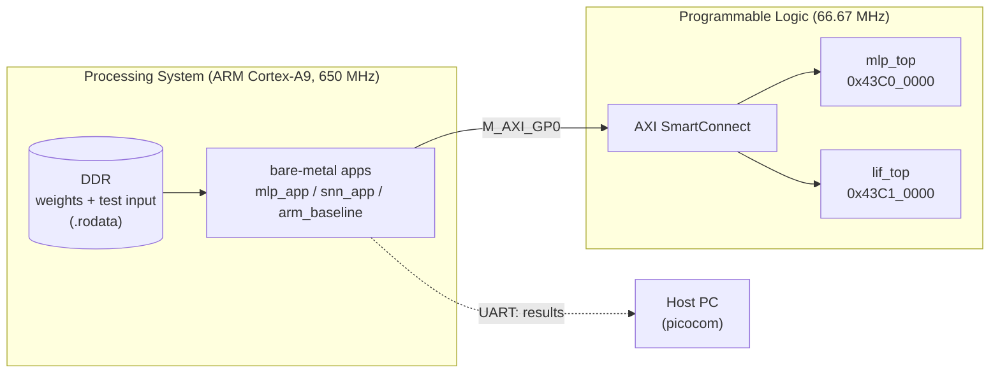
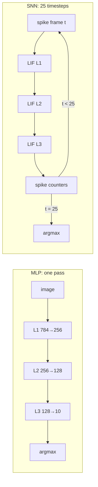
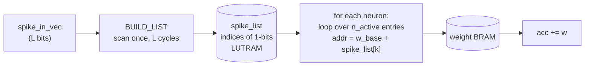

# LIF vs MLP on Zynq

<!-- banner: docs/images/banner.png -->

This project builds two neural-network accelerators in Verilog, runs them on a **ZedBoard (Zynq-7020)**, and compares them on the same MNIST task against each other and against plain C on the ARM core:

- an **int8 MLP** (multi-layer perceptron)
- a **spiking neural network** made of **LIF neurons** (leaky integrate-and-fire)

Each accelerator is a custom IP with an **AXI-Lite** register interface. The ARM core loads the weights at runtime, sends in an image, and reads back the prediction and the hardware cycle counters.

> **Status:** both accelerators and the ARM C baseline pass on the board and match the Python golden models bit for bit.

## Key results

| | Latency per image | vs PL MLP |
|---|---|---|
| PL MLP | **7.07 ms** | 1x |
| ARM C, `-O2` (Cortex-A9, 650 MHz) | **1.72 ms** | 4.1x faster |
| PL SNN, original datapath | 176.5 ms | 25.0x slower |
| PL SNN, event-driven datapath | **29.3 ms** | 4.1x slower |

1. **Event-driven processing made the SNN 6.02x faster.** The SNN's inputs are 83.8 % zeros. The original datapath still spent 2 cycles on every zero. The event-driven version visits only the inputs that spiked. The cycle count dropped from 11,767,299 to 1,955,577, with bit-identical results. The simulated and measured cycle counts match exactly.
2. **The SNN is still slower than the MLP.** It runs 25 timesteps per image. At the measured spike rate it would need about 6 timesteps, or about 3 % active inputs, to match the MLP.
3. **The ARM core beats both accelerators.** Both datapaths are serial: one multiply-accumulate (MAC) every 2 cycles at 66.67 MHz. The CPU at 650 MHz with `-O2` does about 4x more MACs per second. To win, the PL needs parallel MACs, not only a faster clock (see [Next steps](#next-steps)).

---

## System overview



<!-- screenshot: docs/images/block_design.png (Vivado block design) -->

## The two networks

Both networks use the same shape: **784 → 256 → 128 → 10**.

| | MLP | SNN (LIF) |
|---|---|---|
| Input | 784 int8 pixels | 784 spikes per timestep, 25 timesteps |
| Neuron | MAC, then requantise (`>>>`) + bias, ReLU, saturate to int8 | membrane decay `(v·243)>>8`, add `w<<1` on each input spike, fire at 256, reset to 0 |
| Output | 10 int8 logits, argmax | 10 spike counts, argmax |
| Weights | int8, plus biases | int8, no biases |
| One image | 1 forward pass | 25 forward passes (one per timestep) |



## Results

Measured on the ZedBoard: PL at 66.67 MHz, Cortex-A9 at 650 MHz, one MNIST test image. Every run below matches its golden model exactly.

### Outputs

| | MLP (PL and ARM C) | SNN (both datapaths) |
|---|---|---|
| Prediction | 1 | 6 |
| Output | logits `[-77, 80, -41, 4, 0, -61, -56, 11, -28, -32]` | counts `[3, 0, 0, 0, 1, 2, 12, 0, 4, 0]` |

### Latency

| Implementation | Cycles per image | Latency per image | MAC rate |
|---|---|---|---|
| PL MLP | 471,085 (PL) | 7.07 ms | 33 M/s |
| ARM C MLP, `-O0` | n/a | 7.78 ms | 30 M/s |
| ARM C MLP, `-O2` | n/a | 1.72 ms | 136 M/s |
| PL SNN, original | 11,767,299 (PL) | 176.5 ms | n/a |
| PL SNN, event-driven | 1,955,577 (PL) | 29.3 ms | n/a |

- PL latencies count compute cycles only. The PS-side time adds about 1 ms for the SNN (25 spike-frame writes and status polls) and under 1 ms for the MLP.
- Loading all weights over AXI-Lite takes about 81 ms per IP, one byte per write. This happens once after programming and is not part of the per-image latency.
- MAC rate = 234,752 MACs per image ÷ latency.

### SNN work per image

| | Original | Event-driven |
|---|---|---|
| Synaptic operations performed (input spike = 1) | 948,334 | 948,334 |
| Synaptic operations skipped (input spike = 0) | 4,920,466 (83.8 %) | 4,920,466 (83.8 %) |
| Cycles spent on skipped operations | 2 each | **0** |
| Weight memory reads | 5,868,800 | about 0.95 M |

## The event-driven SNN datapath

In the original `lif_layer`, every neuron walked all of its inputs at 2 cycles each (address, then accumulate), and only *counted* the zero spikes. So one SNN timestep cost the same as a full MLP pass: about 470k cycles.

The event-driven version splits each layer pass into two phases:



1. **BUILD_LIST** (once per layer per timestep): scan `spike_in_vec` one bit per cycle, and write the index of every 1-bit into a small LUTRAM list.
2. **Per neuron**: loop only over the `n_active` list entries. The weight address is `w_base + spike_list[k]`, where `w_base` steps by `L` per neuron. This also removes the `neuron_idx × L` multiplier from the address path.
3. **Skipped count**: add `L − n_active` once per neuron, so the `SKIPPED` register keeps its meaning.

Cycles per neuron went from `2L + 3` to `2·n_active + 3`, plus `L` cycles per layer for the list. The module interface did not change, so `lif_top`, the driver and the testbench are unchanged.

## Register map (both IPs, 4 KB each)

| Offset | Name | Access | Meaning |
|---|---|---|---|
| `0x000` | CTRL | RW | `[0]` start, `[1]` soft reset |
| `0x004` | STATUS | RO | MLP: `{rejected, ready, running, done}`. SNN: `{chain_ready, pass_done, running, done}` |
| `0x008` | CYCLES | RO | hardware compute cycles |
| `0x00C` | SKIPPED | RO | SNN only: skipped synaptic operations |
| `0x010` | PDATA | W/R | write one weight byte (the write pointer then increments). Read returns the pointer |
| `0x014` | PCTRL | W/R | `[1:0]` layer, `[2]` reset pointer, `[3]` MLP only: 0 = weights, 1 = bias |
| `0x018` | IN_DATA | W | input words (MLP: 4 pixels per word; SNN: 32 spikes per word) |
| `0x01C` | IN_PTR_RST | W | reset the input pointer |
| `0x020` | PRED | RO | predicted class |
| `0x040`–`0x048` | LOGITS / COUNTS | RO | 10 × 8-bit results |

## Repository layout

```
rtl/            Verilog: mlp_top, mlp_layer, lif_top, lif_layer, AXI-Lite slaves, weight_bram
testbenches/    self-checking testbenches + AXI load tasks
python/         training, fixed-point model, LIF reference model
weights/, data_layer/, spike/   quantised weights, test image, spike trains (hex)
vivado/         block design recreate script (write_bd_tcl)
ip_repo/        packaged IPs (mlp-ip, lif-ip)
sw/
  mlp/, snn/    bare-metal drivers + test apps (Vitis 2025.2, standalone)
  arm/          ARM-only C reference of the MLP, bit-exact with the RTL, for the CPU baseline
  python/       generate C headers (weights, test input, golden values) from the hex files
  xsdb/         JTAG run script
legacy/         earlier per-layer design and outputs
```

## How to reproduce

1. **Simulate.** Run `testbenches/mlp_top_tb.v` and `testbenches/lif_top_testbench.v` in Vivado xsim or Icarus Verilog (`iverilog -g2012`). Run them from the repo root, so the relative paths to the weight and spike files resolve. Each testbench checks its result against the golden values.
2. **Hardware.** In Vivado, recreate the block design from `vivado/design_1.tcl`. Add `ip_repo/` as an IP repository. Generate the bitstream, then export the XSA with the bitstream included.
3. **Headers.** Run:
   ```
   python3 sw/python/gen_mlp_headers.py --repo . --out sw/mlp
   python3 sw/python/gen_snn_headers.py --repo . --out sw/snn
   ```
   The ARM baseline uses the same `mlp_weights.h` and `mlp_test_image.h` as `sw/mlp`.
4. **Vitis.** Create a platform from the XSA (standalone, `ps7_cortexa9_0`). Create one application each from `sw/mlp`, `sw/snn` and `sw/arm`, then build. For the ARM baseline, set the optimisation level in `UserConfig.cmake`.
5. **Run.** Set the boot jumpers to JTAG. Open a serial terminal at 115200 baud on the UART port, press a key, and click Run. Expect `=== MLP PASS ===`, `=== SNN PASS ===` and `=== ARM PASS ===`.

## Design notes

- **Timing.** Both argmax blocks started as serial compare chains, about 20 logic levels deep. They were rewritten as 4-level compare trees, which met timing at 66.67 MHz. The remaining critical paths are the BRAM read followed by the MAC, and, in the event-driven SNN, the LUTRAM read followed by the address add.
- **Weights at runtime.** The BRAM `$readmemh` init is for simulation only. On the board, the ARM streams every weight byte through PDATA, and reads back each layer's write pointer to verify the count.
- **SNN reset.** After a reset, each LIF layer clears its membrane BRAM, which takes 256 cycles. The driver waits for `CHAIN_READY` before starting.
- **Verification.** Simulated cycle counts match the hardware counters exactly for both SNN datapaths, so the testbench is a cycle-accurate proxy for the board.

## Limitations

- Results come from one test image. Accuracy on the full MNIST test set has not been measured.
- Power and energy have not been measured.
- The ARM baseline was measured at `-O0` and `-O2` only. `-O3` with NEON has not been measured and would likely be faster still.
- Weights are loaded one byte per AXI-Lite write (about 81 ms per IP). A DMA or AXI-Stream path would be much faster.

## Next steps

- **Parallel MACs.** Process several inputs per cycle using DSP48 slices and wider BRAM reads, and pipeline the weight read to 1 cycle per MAC. For example, 8 parallel MACs would bring the MLP to about 30k cycles (about 0.44 ms), roughly 4x faster than ARM `-O2` at the same 66.67 MHz clock.
- **Pipelined SNN weight read.** Removing the address wait cycle should take the event-driven SNN to about 1.0M cycles (about 15 ms).
- **Fewer timesteps.** Sweep the timestep count against accuracy in Python, to find where the SNN can match the MLP.
- **Full test-set accuracy and power**, measured on the board.
